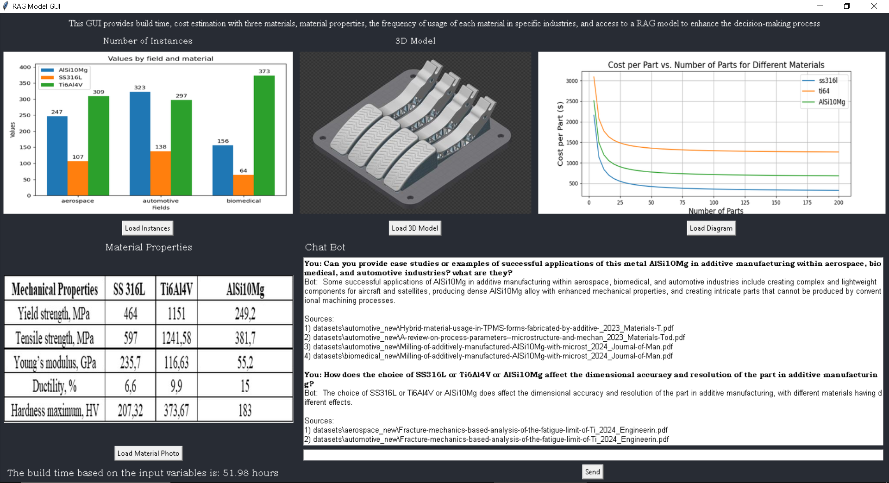

# RAG Project

A Retrieval-Augmented Generation (RAG) model built with LangChain, ChromaDB and OpenAI, with a Tkinter GUI. It answers questions using a collection of research articles from three fields: automotive, biomedical and aerospace. The GUI also shows a cost diagram and estimates the build time (T_build) from input variables.



## Project structure

| File / folder | Description |
|---|---|
| `GUI/` | Screenshots of the GUI. |
| `json create/` | Notebooks that use the Elsevier Scopus API (`elsapy`) to search for and collect article metadata. `json_create.ipynb` is the main notebook, `test.ipynb` was used for testing, and `Automotive.json` / `dump.json` are example outputs. |
| `pictures/` | Pictures of the 3D model, instances diagram, instances and material properties. These are shown in the GUI. |
| `diagram.py` | Creates the cost diagram and saves it as `diagram.jpeg`. It also calculates T_build and saves it to `T_build_value.txt`. It runs when the GUI starts and when you press the "Load 3D model" button. Input values are written manually in `gui_rag.py`. |
| `diagram.jpeg` | The cost diagram created by `diagram.py`. Used in the GUI. |
| `T_build_value.txt` | The T_build value calculated by `diagram.py`. It is rewritten every time `diagram.py` runs. |
| `instances_diagram.py` | Creates the instances diagram (`instances_diagram.jpeg`). |
| `model.ipynb` | Notebook used to create and test the RAG model, and to add additional articles to the database. |
| `model.py` | The RAG model used by the GUI. |
| `scraping.ipynb` | Counts the number of instances in the articles. |
| `gui_rag.py` | Creates the GUI. Uses `model.py` and `diagram.py`. |
| `requirements.txt` | List of Python libraries needed to run the project. |

## Not included in this repository

These folders are needed to run the project but are not uploaded to GitHub:

- **`datasets/`**: the PDF articles, sorted into one subfolder per field (automotive, biomedical, aerospace), plus an `additional_new` folder with 25 more articles. The articles are not included for copyright reasons. Create a `datasets` folder in the main folder and put your own PDFs in it with the same structure. `model.py`, `model.ipynb` and `scraping.ipynb` read the articles from there.
- **`chroma/`**: the ChromaDB vector database. It is created from the PDFs in `datasets/` when you run `model.ipynb`.
- **`.venv/`**: the Python virtual environment. Create your own using the steps below.
- **`json create/config.json`**: contains the Elsevier API key (see below).

## Setup

You need to use a Python virtual environment and work from it. Environments avoid conflicts between library versions.

1. Clone the repository and open the main folder (for example in VS Code).
2. Create and activate a virtual environment:
   ```bash
   python -m venv .venv
   # Windows
   .venv\Scripts\activate
   # macOS / Linux
   source .venv/bin/activate
   ```
3. Install the libraries:
   ```bash
   pip install -r requirements.txt
   ```
4. Add your OpenAI API key in `model.py` and `model.ipynb`, where it says `openai_api_key = 'SOME_KEY'`.
5. To use the notebooks in `json create/`, create a `config.json` file in that folder with your Elsevier API key:
   ```json
   {
       "apikey": "YOUR_ELSEVIER_API_KEY"
   }
   ```
6. Add your PDFs to the `datasets/` folder and run `model.ipynb` to build the `chroma/` database.
7. Run the GUI:
   ```bash
   python gui_rag.py
   ```